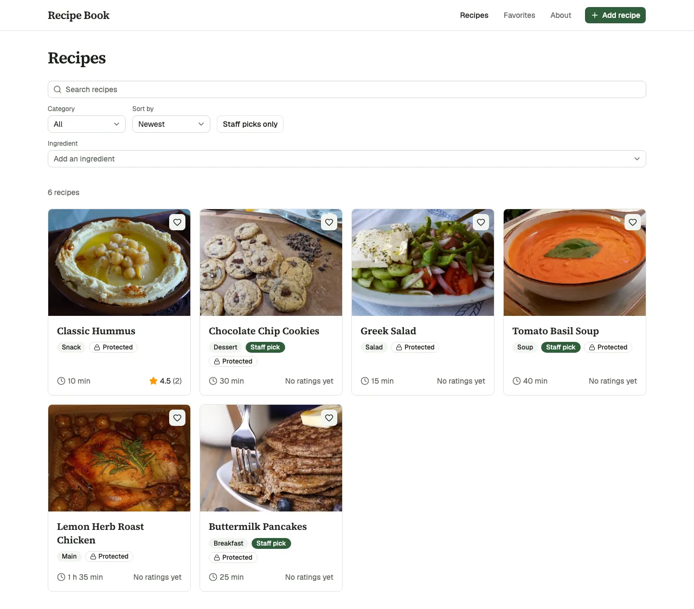
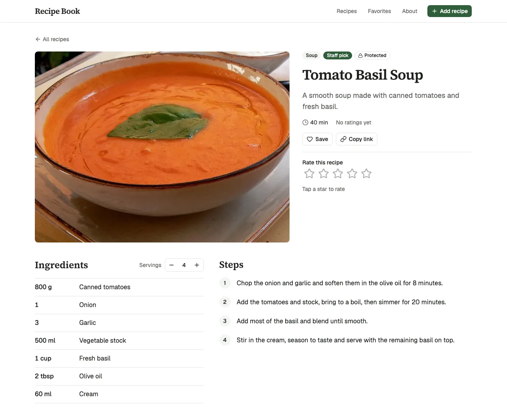
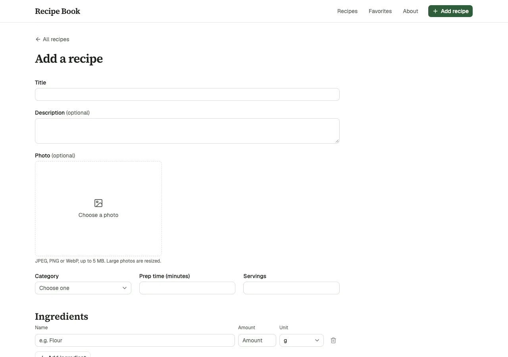
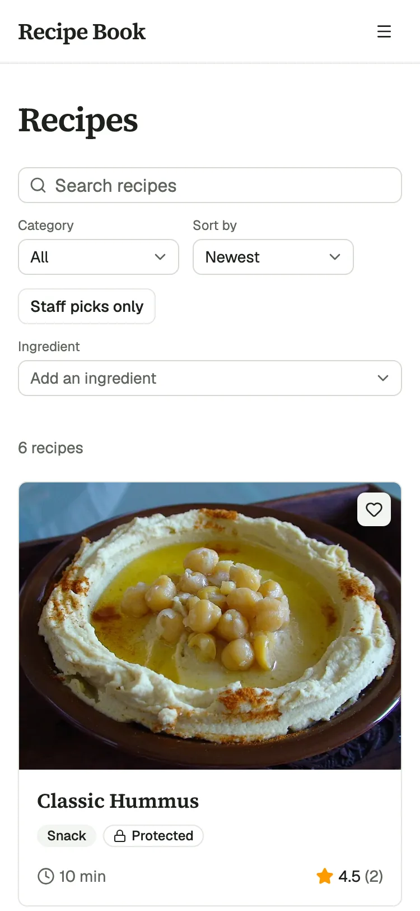
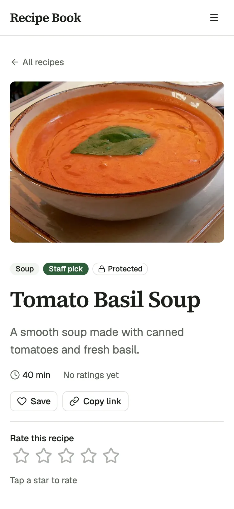
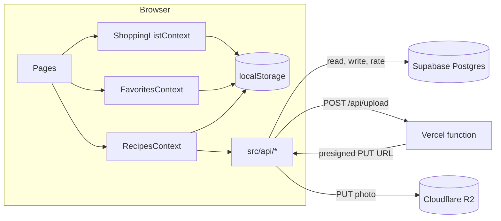

# Recipe Book

A public recipe book built with React for a university frontend course. Anyone can browse recipes, filter them by category or ingredient, scale ingredient amounts to the number of servings, rate recipes, save favorites on their device, build a shopping list from recipes, and add their own recipes with a photo.

- **Live site:** https://interactive-recipe-book-five.vercel.app
- **Repository:** https://github.com/VarithPheng/Interactive-Recipe-Book

<!-- TODO(user): team member names (and student IDs if required) -->

| Name | Role |
| ---- | ---- |
|      |      |

## Screenshots

| Browse | Recipe detail |
| ------ | ------------- |
|  |  |

| Add a recipe | Mobile (375 px) |
| ------------ | --------------- |
|  |   |

## Features

| #   | Feature                                                                                                   | Page             | Done |
| --- | --------------------------------------------------------------------------------------------------------- | ---------------- | ---- |
| F1  | Six starter recipes load on first visit                                                                   | Browse           | ✅   |
| F2  | Title search that waits 300 ms after you stop typing (`useDebounce`); filters are kept in the URL, so Back, refresh and shared links keep them | Browse | ✅ |
| F3  | Category filter: All plus 7 categories                                                                    | Browse           | ✅   |
| F4  | Ingredient filter: pick ingredients from a list; recipes must contain every one (include only)           | Browse           | ✅   |
| F5  | Sort by newest, quickest or top rated                                                                     | Browse           | ✅   |
| F6  | "Staff pick" badge and a "Staff picks only" filter                                                        | Browse           | ✅   |
| F7  | Servings scaler; amounts scale and round to 2 decimals                                                    | Detail           | ✅   |
| F8  | Add a recipe with inline validation, success toast and redirect                                           | Form             | ✅   |
| F9  | Edit your own recipes (pre-filled form)                                                                   | Form             | ✅   |
| F10 | Delete your own recipes after a confirmation dialog; starter recipes show a lock badge and no buttons     | Detail           | ✅   |
| F11 | Photo upload: pick any photo (phones included), preview, compress to JPEG in the browser, upload to Cloudflare R2 | Form             | ✅   |
| F12 | Favorite heart on cards and detail page; Favorites page; saved across refreshes                           | Detail, Favorites | ✅  |
| F13 | 1 to 5 star ratings, one per device; average and count on cards; your own rating remembered               | Detail, Browse   | ✅   |
| F14 | "Copy link" puts the recipe's full URL on the clipboard                                                   | Detail           | ✅   |
| F15 | ~~Dark mode~~: removed by team decision; the app uses one light theme                                     | n/a              | ➖   |
| F16 | Responsive layout: 1, 2, 3 or 4 columns; tested at 375, 768 and 1280 px                                   | All              | ✅   |
| F17 | Skeleton loading states matched to each page, error panel with retry, empty states, toasts                | All              | ✅   |
| F18 | Shopping list: add a recipe's ingredients at the chosen servings; same ingredients merge; select, remove (with undo), copy as text | Detail, Shopping list | ✅ |

Pages: Browse (`/`), Recipe detail (`/recipes/:id`), Add and edit (`/recipes/new`, `/recipes/:id/edit`), Favorites (`/favorites`), Shopping list (`/shopping-list`), About (`/about`), and a not-found page for any other URL.

## Tech stack

| Area          | Choice                                                                 |
| ------------- | ---------------------------------------------------------------------- |
| Framework     | Vite, React 18, TypeScript (strict)                                    |
| Routing       | `react-router-dom` v6                                                  |
| UI            | Tailwind CSS v4, shadcn/ui (Radix), lucide icons, Sonner toasts        |
| Global state  | React Context with `useReducer`                                        |
| Forms         | `react-hook-form` with its built-in validation rules                   |
| Database      | Supabase Postgres (no login), protected with Row Level Security        |
| Photos        | Cloudflare R2, uploaded with a presigned URL from a Vercel function    |
| Hosting       | Vercel (static site plus one `/api` function)                          |
| Tooling       | Bun, Prettier, oxlint                                                  |

## Architecture



### Global state (React Context)

| Context            | What it owns                                                                                       | Why it is global                                                                 |
| ------------------ | -------------------------------------------------------------------------------------------------- | -------------------------------------------------------------------------------- |
| `RecipesContext`   | All recipes, loading/error status (`useReducer`), and this device's own ratings                    | Browse, Detail, Form and Favorites all read the same list, so it is fetched once |
| `FavoritesContext` | The ids of favorite recipes, saved in localStorage and kept in sync across open tabs               | The heart appears on cards, the detail page and the Favorites page               |
| `ShoppingListContext` | Shopping list lines (merged by ingredient name and unit, with a selected flag), saved in localStorage | The Detail page adds to it; the Shopping list page reads and edits it |

`RecipesContext` loads recipes in a `useEffect` and exposes `reload()` for the retry button. Creating and editing wait for the server. Deleting and rating update the screen straight away and roll back with an error toast if the server refuses. Filtering and sorting happen in the browser with `useMemo`. The filters are read from the URL (`useSearchParams`), so they survive Back, refresh and sharing.

### Custom hooks

| Hook                        | Purpose                                                                                                  |
| --------------------------- | -------------------------------------------------------------------------------------------------------- |
| `useLocalStorage(key, initial)` | `useState` that reads from localStorage once and writes back in a `useEffect`; bad JSON falls back to `initial` |
| `useDebounce(value, ms)`    | Returns the value only after it stops changing, used for search                                          |
| `useImageUpload()`          | Validates, compresses to JPEG, makes a preview URL (revoked in the effect cleanup) and starts the upload as soon as a photo is picked |

### Security without login

There is no login, so the database enforces ownership itself:

- The six starter recipes have `can_delete = false`. Row Level Security blocks updating or deleting them with the public key, even when calling the API directly.
- Recipes added through the app have `can_delete = true` and can be edited or deleted.
- Ratings can only be written through the `rate_recipe` function, one per device and recipe. The ratings table cannot be read or written directly.
- The R2 keys stay on the server. The browser gets a presigned upload URL that is signed for one JPEG of the exact size (2 MB at most) and expires after 60 seconds. Compressing in the browser also removes photo metadata such as location.

## Project structure

```
api/upload.ts            Vercel function: presigned R2 upload URL
supabase/                SQL: schema and policies, seed data, seed photo path update
src/
  App.tsx, main.tsx      Routes and providers
  pages/                 Browse, RecipeDetail, RecipeForm, Favorites, ShoppingList, About, NotFound
  components/layout/     Layout, Navbar
  components/recipe/     Card, grid, filters, form, photo picker, stars, skeletons, ...
  components/ui/         shadcn/ui components
  context/               RecipesContext, FavoritesContext, ShoppingListContext
  hooks/                 useLocalStorage, useDebounce, useImageUpload
  lib/                   types, filters, formatting, image resizing, Supabase client, page loaders
  api/                   recipes, ratings, upload
```

## Run it locally

You need [Bun](https://bun.sh), a [Supabase](https://supabase.com) project, a [Cloudflare R2](https://developers.cloudflare.com/r2/) bucket with public access, and the [Vercel CLI](https://vercel.com/docs/cli).

1. **Install**

   ```bash
   git clone https://github.com/VarithPheng/Interactive-Recipe-Book.git
   cd Interactive-Recipe-Book
   bun install
   ```

2. **Environment variables:** copy the template and fill it in.

   ```bash
   cp .env.example .env
   ```

   | Variable                        | Where to find it                                         |
   | ------------------------------- | -------------------------------------------------------- |
   | `VITE_SUPABASE_URL`             | Supabase: Project Settings, API                          |
   | `VITE_SUPABASE_PUBLISHABLE_KEY` | Supabase: the publishable (anon) key                     |
   | `R2_ACCOUNT_ID`                 | Cloudflare R2 overview                                   |
   | `R2_ACCESS_KEY_ID`, `R2_SECRET_ACCESS_KEY` | R2 API token with Object Read & Write on the bucket |
   | `R2_BUCKET`                     | The bucket name                                          |
   | `R2_PUBLIC_URL`                 | The bucket's public URL, for example `https://pub-xxxx.r2.dev` |

   The `R2_*` variables are server-only. Never prefix them with `VITE_`.

3. **Database:** in the Supabase SQL editor, run `supabase/001_init.sql`, then `supabase/seed.sql`. If Supabase asks about RLS when running the seed, choose "Run without RLS": the seed only inserts rows.

4. **R2 CORS:** allow `PUT` with the `Content-Type` header from `http://localhost:3000` and your production URL.

5. **Start the app**

   ```bash
   vercel link   # once
   vercel dev    # app and /api on http://localhost:3000
   ```

   `bun run dev` also works for everything except photo upload, because plain Vite does not run the `/api` function.

### Scripts

| Command                | What it does                                       |
| ---------------------- | -------------------------------------------------- |
| `bun run dev`          | Vite dev server (no `/api`)                        |
| `bun run build`        | Type check app, config and API, then build         |
| `bun run typecheck`    | Type check the app only                            |
| `bun run lint`         | oxlint                                             |
| `bun run format`       | Format everything with Prettier                    |
| `bun run format:check` | Check formatting without changing files            |
| `bun run preview`      | Serve the production build                         |

## Deployment

Vercel builds the site with `bun run build`. Set all seven environment variables in the Vercel project, then redeploy. `vercel.json` sends page URLs to `index.html`, so refreshing a deep link such as `/recipes/<id>` works.

## Quality checks

- Lighthouse on the production build: performance 90 to 100, accessibility 100, best practices 100, SEO 100.
- No layout shift on any page (CLS 0 on mobile and desktop): each page has a skeleton with the same layout as the loaded page.
- Every page except Browse is loaded on first visit (`React.lazy`), so the first page load stays small.

## Photo credits

Starter recipe photos come from Wikimedia Commons, resized and converted to WebP.

| Recipe                   | Original                                                                                                                       | Author                          | License                                                              |
| ------------------------ | ------------------------------------------------------------------------------------------------------------------------------ | ------------------------------- | -------------------------------------------------------------------- |
| Buttermilk Pancakes      | [Slicing Pancakes with Fork 374819.jpg](https://commons.wikimedia.org/wiki/File:Slicing_Pancakes_with_Fork_374819.jpg)         | Shared Food                     | [CC0](http://creativecommons.org/publicdomain/zero/1.0/deed.en)      |
| Lemon Herb Roast Chicken | [Roasted Chicken with Potato.jpg](https://commons.wikimedia.org/wiki/File:Roasted_Chicken_with_Potato.jpg)                     | Onny Nagathan                   | [CC BY-SA 4.0](https://creativecommons.org/licenses/by-sa/4.0)       |
| Tomato Basil Soup        | [Basil and Organic Tomato Soup.jpg](https://commons.wikimedia.org/wiki/File:Basil_and_Organic_Tomato_Soup.jpg)                 | SirNico                         | [CC BY-SA 3.0](https://creativecommons.org/licenses/by-sa/3.0), cropped |
| Greek Salad              | [Greece Food Horiatiki.JPG](https://commons.wikimedia.org/wiki/File:Greece_Food_Horiatiki.JPG)                                 | User:Jpatokal                   | [CC BY-SA 4.0](https://creativecommons.org/licenses/by-sa/4.0)       |
| Chocolate Chip Cookies   | [Chocolate chip cookies on cutting board.jpg](https://commons.wikimedia.org/wiki/File:Chocolate_chip_cookies_on_cutting_board.jpg) | Mshuang2                    | [CC0](http://creativecommons.org/publicdomain/zero/1.0/deed.en)      |
| Classic Hummus           | [Lebanese style hummus.jpg](https://commons.wikimedia.org/wiki/File:Lebanese_style_hummus.jpg)                                 | Beyrouthhh at English Wikipedia | [CC BY 3.0](https://creativecommons.org/licenses/by/3.0)             |
